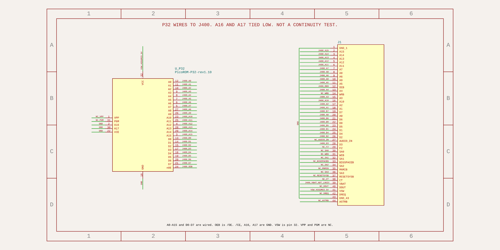

# PicoROM-32 cartridge schematic (preliminary)

The working schematic is an upstream [PicoROM-32](https://github.com/wickerwaka/PicoROM) module on the J400 line numbers in [`J400-cartridge-port-pinout.csv`](J400-cartridge-port-pinout.csv). The circuit is [`tscircuit/picorom-p32-carrier.circuit.tsx`](tscircuit/picorom-p32-carrier.circuit.tsx). The picture below is generated from that source. It is the chosen reference mapping. It is not a continuity-tested pinout, and it is not a fabrication or power-up release.



A bare Raspberry Pi Pico is not this design. The previous PicoROM-28 carrier is not the current sheet. The supported part is the 32-pin module.

Nothing here is fabrication-ready. There is no cartridge PCB layout. The DIP-32 and 44-pin header footprints are build scaffolding. `routingDisabled` is set.

Related open issues, not closed here: [#51](https://github.com/webaugur/Maxx-Steele-1984-Robot/issues/51), [#53](https://github.com/webaugur/Maxx-Steele-1984-Robot/issues/53) (stock `P32_27C020_70ns` is the firmware under test; robot timing is still unmeasured), [#54](https://github.com/webaugur/Maxx-Steele-1984-Robot/issues/54) (the module is the PicoROM-32; this change does not check store stock), [#46](https://github.com/webaugur/Maxx-Steele-1984-Robot/issues/46), [#25](https://github.com/webaugur/Maxx-Steele-1984-Robot/issues/25), [#26](https://github.com/webaugur/Maxx-Steele-1984-Robot/issues/26), [#27](https://github.com/webaugur/Maxx-Steele-1984-Robot/issues/27), [#50](https://github.com/webaugur/Maxx-Steele-1984-Robot/issues/50), [#49](https://github.com/webaugur/Maxx-Steele-1984-Robot/issues/49).

## Module

- Repository: `wickerwaka/PicoROM`
- Commit: `dddab41f9a47c7666115837b50b93eb78c221e33` (2026-10-25, "Gerbers"). That commit is still `main`.
- Schematic title **PicoROM-32 - ROM Emulator**, rev **1.10**, date **2026-10-24**
- Firmware target `P32_27C020_70ns` with `BOARD_32P=1`, version string **2.0**. `ROM_SIZE` is `0x40000` (256 KB, A0–A17). `P32_27C020_100ns` is the same board with `FEATURE_STABLE_ADDRESS`. `POG` and `BOARD_32P_TCA` are different hardware.
- Pin map in `firmware/system.h`: address GPIO0–17, data GPIO18–25, the single sampled enable GPIO26, buffer `/OE` GPIO27. There is no `BUF_DIR` pin on `BOARD_32P`. `pio_programs.cpp` uses `route_output_enable` when `N_OE_PINS` is 1.

On the rev 1.10 PCB, U7 (`74LVC1G32`) ORs DIP `/OE` and `/CE` into that one RP2040 enable. Both must be low for the output to be low. This carrier straps `/CE` to ground and connects J400 `OEB` to `/OE`, so the enable follows `OEB`.

A16 (pin 2) and A17 (pin 30) are tied to ground. The robot's A0–A15 then select the first 64 KB of the 256 KB image. There is no bank switch. Pin 1 (`VPP`) and pin 31 (`PGM` on a 27C020) have header pads and no copper net inside the module, so the carrier leaves them NC.

## Why there is no external HCT245

Checked on the PicoROM-32 PCB, not copied from the 28-pin board:

- U4, U5, and U9 are `74LVC245` at `+3V3_SYS`. DIR is ground, so the DIP address pins are inputs.
- U10 value text is `74LVC8245`, MPN `C548858` (Nexperia 74LVC8T245BQ,118), footprint DHVQFN-24. VCC(A) and DIR are both `+3V3_SYS`, so direction is fixed A toward B. VCC(B) is `+5V_SYS`, the DIP data pins. The KiCad symbol is still `SN74AVC8T245PW`.
- TI SN74LVC8T245 lists VOH minimum 3.8 V at 4.5 V and −32 mA, and VOL maximum 0.55 V at 32 mA. The published NMOS 6502 limits are VIH minimum 2.0 V and VIL maximum 0.8 V. The repo's 6502 PDF is an image scan. Nexperia's own VOH table was not downloaded.
- An external HCT245 would be a second tri-state driver on pins U10 already drives at 5 V.

Power is in [`POWER.md`](POWER.md). The carrier bill of materials is the module plus the edge connector. No 7805.

## Build and edit

From `Cartridge/PicoROM/tscircuit`, with [Bun](https://bun.sh) on `PATH`:

```bash
npm ci
export PATH="$HOME/.bun/bin:$PATH"
npm test
npm run check
npm run export
node --input-type=module -e 'import { readFileSync, writeFileSync } from "node:fs"; import { Resvg } from "@resvg/resvg-js"; const svg = readFileSync("../render/picorom-p32-carrier-schematic.svg"); const png = new Resvg(svg, { fitTo: { mode: "width", value: 2000 }, background: "white" }).render(); writeFileSync("../render/picorom-p32-carrier-schematic.png", png.asPng())'
```

Stock firmware, from a PicoROM checkout at `dddab41` with its `firmware/pico-sdk` submodule (`a1438dff`):

```bash
cmake -S firmware -B build
cmake --build build --target P32_27C020_70ns
```

That produced `PicoROM-P32_27C020_70ns-2_0.uf2` here. It was not flashed, and the 70 ns / 40 ns figures were not remeasured on the robot.

`npm test` rebuilds [`render/picorom-p32-carrier.net.txt`](render/picorom-p32-carrier.net.txt) and checks `COMPONENT_PINS` endpoints and DIP pin numbers. Passing checks do not prove the robot can read the cartridge.

Rendered files:

- [`render/picorom-p32-carrier-schematic.svg`](render/picorom-p32-carrier-schematic.svg)
- [`render/picorom-p32-carrier-schematic.png`](render/picorom-p32-carrier-schematic.png)
- [`render/picorom-p32-carrier.net.txt`](render/picorom-p32-carrier.net.txt)
- [`render/picorom-p32-carrier.circuit.json`](render/picorom-p32-carrier.circuit.json)
