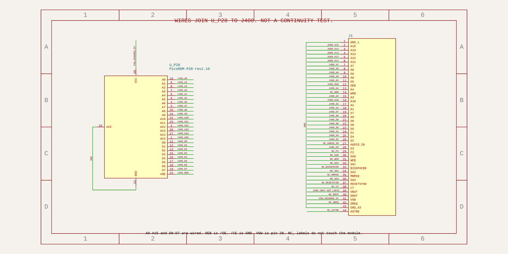

# PicoROM-28 cartridge schematic (preliminary)

The working schematic is an upstream [PicoROM-28](https://github.com/wickerwaka/PicoROM) module on the J400 line numbers in [`J400-cartridge-port-pinout.csv`](J400-cartridge-port-pinout.csv). The circuit is [`tscircuit/picorom-carrier.circuit.tsx`](tscircuit/picorom-carrier.circuit.tsx). The picture below is generated from that source. It is the chosen reference mapping. It is not a continuity-tested pinout, and it is not a fabrication or power-up release.



A bare Raspberry Pi Pico with external DIP 245 buffers is not this design. That split GPIO map cannot run stock PicoROM firmware. It is no longer in this project. The supported part is the PicoROM-28 module, whose RP2040 pinout is inside the module.

Nothing here is fabrication-ready. There is no cartridge PCB layout. The DIP-28 and 44-pin header footprints are build scaffolding. `routingDisabled` is set.

Related open issues, not closed here: [#51](https://github.com/webaugur/Maxx-Steele-1984-Robot/issues/51), [#53](https://github.com/webaugur/Maxx-Steele-1984-Robot/issues/53) (stock firmware is the map under test; robot timing is still unmeasured), [#54](https://github.com/webaugur/Maxx-Steele-1984-Robot/issues/54) (the module is the PicoROM-28; this change does not check whether one is in stock), [#46](https://github.com/webaugur/Maxx-Steele-1984-Robot/issues/46), [#25](https://github.com/webaugur/Maxx-Steele-1984-Robot/issues/25), [#26](https://github.com/webaugur/Maxx-Steele-1984-Robot/issues/26), [#27](https://github.com/webaugur/Maxx-Steele-1984-Robot/issues/27), [#50](https://github.com/webaugur/Maxx-Steele-1984-Robot/issues/50), [#49](https://github.com/webaugur/Maxx-Steele-1984-Robot/issues/49), [#47](https://github.com/webaugur/Maxx-Steele-1984-Robot/issues/47), [#48](https://github.com/webaugur/Maxx-Steele-1984-Robot/issues/48).

## Module

- Repository: `wickerwaka/PicoROM`
- Commit: `dddab41f9a47c7666115837b50b93eb78c221e33` (2026-10-25, "Gerbers"). That commit is still `main`.
- Schematic title **PicoROM-28 - ROM Emulator**, rev **1.10**, date **2026-10-24**
- Firmware: `firmware/CMakeLists.txt` target `P28_27C512_70ns` with `BOARD_28P=1`, version string **2.0**. `P28_27C512_100ns` is the same board with `FEATURE_STABLE_ADDRESS`.
- Pin map in `firmware/system.h`: address GPIO0–15, data GPIO16–23, `/OE` GPIO24, `/CE` GPIO25, buffer `/OE` GPIO26, buffer direction GPIO27.

## Why there is no external HCT245

On the rev 1.10 PCB:

- U4, U5, and U9 are `74LVC245` at `+3V3_SYS`. DIR and `/OE` pads are ground, so the DIP address, `/CE`, and `/OE` pins are inputs. SN74LVC245A inputs accept up to 5.5 V. Those parts do not drive the robot bus.
- U10's value text is `74LVC8245`, its MPN field is `C548858`, and its footprint is DHVQFN-24. LCSC C548858 is Nexperia **74LVC8T245BQ,118**. The KiCad symbol is still `SN74AVC8T245PW`; the MPN and footprint are the LVC part. VCC(A) is `+3V3_SYS` (RP2040 data). VCC(B) is `+5V_SYS` (DIP data). `rom.cpp` holds `BUF_DIR` high, which this transceiver defines as A toward B.
- TI SN74LVC8T245, the same function from the other vendor, lists VOH minimum 3.8 V at VCCO 4.5 V and IOH −32 mA, and VOL maximum 0.55 V at IOL 32 mA. The repo's MOS 6502 PDF is an image scan, so it was not text-extracted. The published NMOS 6502 DC table uses VIH minimum 2.0 V and VIL maximum 0.8 V. 3.8 V and 0.55 V meet those limits. Nexperia's own VOH table was not downloaded; its public feature list rates the part for 1.2–5.5 V and ±24 mA at 3.0 V, and cites JESD36 for 4.5–5.5 V.
- An external HCT245 would be a second tri-state driver in series with U10. The upstream circuit does not call for it.

Power and the USB Schottkys are in [`POWER.md`](POWER.md). The carrier BOM is the module plus the edge connector. No 7805.

## Carrier wiring

Address and data follow the 27C512 pin order onto the J400 fingers of the same name. J400 `OEB` is module `/OE`. Module `/CE` is strapped to ground because the reference map has no chip-select contact, and stock firmware enables data only when both `/CE` and `/OE` are low. `WRB` stays open. Details and the remaining unknowns are in [`CONNECTION-INVENTORY.md`](CONNECTION-INVENTORY.md).

## Build and edit

From `Cartridge/PicoROM/tscircuit`, with [Bun](https://bun.sh) on `PATH`:

```bash
npm ci
export PATH="$HOME/.bun/bin:$PATH"
npm test
npm run check
npm run export
node --input-type=module -e 'import { readFileSync, writeFileSync } from "node:fs"; import { Resvg } from "@resvg/resvg-js"; const svg = readFileSync("../render/picorom-carrier-schematic.svg"); const png = new Resvg(svg, { fitTo: { mode: "width", value: 1600 }, background: "white" }).render(); writeFileSync("../render/picorom-carrier-schematic.png", png.asPng())'
```

`npm test` rebuilds the readable netlist and compares it with [`render/picorom-carrier.net.txt`](render/picorom-carrier.net.txt). Passing checks prove the source builds and the nets match the module pin numbers. They do not prove the robot can read the cartridge.

Rendered review files:

- [`render/picorom-carrier-schematic.svg`](render/picorom-carrier-schematic.svg)
- [`render/picorom-carrier-schematic.png`](render/picorom-carrier-schematic.png)
- [`render/picorom-carrier.net.txt`](render/picorom-carrier.net.txt)
- [`render/picorom-carrier.circuit.json`](render/picorom-carrier.circuit.json)
