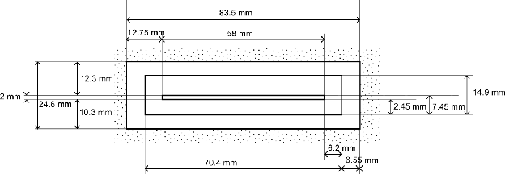
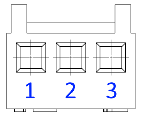

# Chapter 8 — Community reference guide

This chapter records the community Google Doc *The Reference Guide to Programming, Hacking, Modifying, and Restoring a Maxx Steele Personal Robot* and says where each section landed in this archive.

Source URL: https://docs.google.com/document/d/1RSxLh9rSbNDSOTUrXm4flMKmsFEoP6RWNXGQrrtQhjs/edit

Tab returned: `t.0` only. Element count from the export manifest: 196 elements, 62 headings, 9 tables, 1189 cells, 2 recovered diagrams. Revision cited with the pinout work: `AHj4eMTerV6p8oM8x4ORN-S7N5q-3zin1iMaLm2nH32DLN3-UDgSbYavvxt2Mc04yVAXFFyXkbVy76Jb0n3s9g`.

The Doc was not edited. Headers, footers, comments, and the original rich formatting are not certified as complete. The two diagrams were recovered from the Drive Markdown export. Original image URLs and alt text were not in that export. The cartridge drawing is stored as the original transparent PNG and as a white-background copy used below, because black lines on a transparent PNG disappear on a dark page.

Nothing in the source is a measurement made for this archive. Where a later ROM reading disagrees, the ROM chapter stays, and the disagreement is listed here.

## Coverage map

| Source section | Destination | Status |
|---|---|---|
| Title and compiler credit | This chapter | Recorded. Not treated as a factory manual. |
| Hardware Specifications → CPU pinout | This chapter, uncorrected table | Kept, including the author's "there are errors here", the duplicate pin 54, and blank pins 20 and 58. Not reconciled to a datasheet. |
| Hardware Specifications → RAM, ROM, Head Display, Speech Generator, Motor Controller | This chapter | Source headings are empty. That is a gap in the source, not a missing repo file. |
| Scripting bytecodes `$00`–`$0C`, `$81`–`$83` | [Chapter 2](02-Opcode-Vocabulary.md) already has the ROM opcode table | Guide rows are kept below as the community list. They do not replace Chapter 2. |
| Scripting `$04` "Unknown" | Chapter 2 lists `wrist_up` at `$04` | Contradiction. Chapter 2 stands. |
| Scripting `$0D`–`$0F` "Unknown" | Chapter 4 treats `$0E` as a ROM phrase opcode and the demo uses song/speech bytes in that range | Contradiction. Chapter 4 stands. The guide's blank call-location column stays blank. |
| Memory map `$0000`–`$07FF`, `$0200`, `$0400`, `$0500`, `$E000`–`$FFFF` | [Chapter 6](06-Input-Output-Guide.md) and [Chapter 5](05-Cartridge-Bootstrap-and-Internal-ROM.md) | Overlap. Chapter 6 is the working map. |
| `$0800`–`$09FF` "external ram?" | Not adopted | Guide marks it as a suspicion. |
| Cartridge search `$2000`–`$DFFF`, magic `(C) 1985 CBS TOYS`, `$E0B6` | Chapter 5 documents a 4 KB window and the factory demo at `$A000` | The guide's wider search and magic string are kept as its claim. They were not re-derived in this pass. |
| I/O `$1000`, `$1200`, `$1400`, `$1600`, `$1C00`, `$1E00` | Chapter 6 | Guide calls `$1E00` "Motion?" and later "motors". Chapter 6 calls `$1E00` a provisional system power latch. Chapter 6 stands. |
| RAM allocation `$003`–`$500` | This chapter | Guide notes, including uncertain labels such as `$072` = `8200`. Not promoted to the working map. |
| Motors, head display subroutine names | This chapter | Guide notes (`ED4F`, `ED7B`, `F684`, `ED55`, `E9B3`). Not checked against the `.dsm` in this pass. |
| Lights → Eyes, Chest, Arm | This chapter | Source headings are empty. |
| Speech `$1400` bit notes and `LDX #$10` / `JSR $F475` | [Chapter 4](04-Programming-Speech-and-Music.md) | Chapter 4 keeps the ROM driver at `$F3D5` and the phoneme tables at `$F567` / `$F4DB`. The guide's example is additional community text. |
| LC8100 phrases 16–32 and LC3100 word/ROM-address tables | This chapter | Not in Chapter 4. Copied uncorrected, including `OD6B` for Indicate and the phrase spelling "Max Steele". |
| Music → Internal Note Generator, I/O Location, Commands | This chapter | Source headings are empty. Chapter 4 already covers music RAM `$0400`. |
| Light sensor | This chapter | Source headings are empty. |
| Cartridge size and insertion text | This chapter and [J400 pinout](../../Cartridge/PicoROM/J400-PINOUT.md) | 44 contacts, 2.54 mm, 1.6 mm board, 12–18 mm barrier, about 4 inches long: guide text, not a caliper log. |
| Dimensioned drawing | Assets below | Two PNGs. Printed callouts are listed. They are not new measurements. |
| Pinout | Chosen schematic map in [J400-PINOUT.md](../../Cartridge/PicoROM/J400-PINOUT.md) and `Cartridge/PicoROM/J400-cartridge-port-pinout.csv` | Used to wire the PicoROM-28 carrier. Explicitly not continuity-tested. |
| Attaching Sound Memory, External Sound Source, External Memory, External I/O | This chapter | Source headings are empty. |
| RF 27.095 MHz sticker, 1.55 ms, 29 ms, 21 ms, 4×6 matrix, Power/Stop interrupt | [Transmitter architecture](../../Transmitter/transmitter-architecture.md) already has the measured timing | Guide text kept. |
| "internal crystal is 26.840 Hz" | This chapter and a pointer in the transmitter note | Quoted as written. The unit is Hz in the source. The same sentence says the sticker is 27.095 MHz. Not silently changed to MHz. |
| RF I/O location "Unknown as of Feb 10, 2021" | Left as the guide's date | Later repo RF notes are newer and are not a rewrite of this sentence. |
| 25 binary token words | This chapter | Not previously in the transmitter note. Copied as the guide's codes. Not claimed decoded by this archive. |
| 3.5 mm jack: +9 V, Data In, Ground | Pointer added on the transmitter page | The transmitter page already says DataOut is on the jack. The guide's pin names and the sleep-bypass report stay community claims. |
| Receiver Molex KK pins (1) Data Out, (2) VSW, (3) GND; wire colors Blue, Slate/Gray, Green | This chapter, with the connector drawing | "5 Volt logic level and it goes directly into the CPU without external buffering" is the guide's sentence, not a measurement. |
| DigiKey part links | This chapter, copied literally | Each URL contains `/.../`. Targets were not invented. |
| Disassembly | [Mechanical chapter 1](../Mechanical/01-Disassembly.md) | Already cleaned from this text. |
| Reassembly | [Mechanical chapter 2](../Mechanical/02-Reassembly.md) | Already cleaned. Source says twelve screws to remove and fourteen to reinstall. Both numbers are kept. No count was invented to reconcile them. |

## Printed callouts on the cartridge drawing

The drawing says it was converted to millimeters from an inch original. These are the callouts visible on the recovered PNG: 83.5 mm, 12.75 mm, 58 mm, 2 mm, 24.6 mm, 12.3 mm, 10.3 mm, 14.9 mm, 2.45 mm, 7.45 mm, 70.4 mm, 8.2 mm, 8.55 mm. Which edge each callout dimensions is the drawing's own geometry. They were not checked with a caliper.

Original transparent file: [cartridge-port-drawing.png](assets/community-reference-guide/cartridge-port-drawing.png). White-background copy used in the transcription below: [cartridge-port-drawing-on-white.png](assets/community-reference-guide/cartridge-port-drawing-on-white.png). Receiver drawing: [receiver-connector.png](assets/community-reference-guide/receiver-connector.png).

## Omissions that remain

- Only tab `t.0` was in the export. No other tab was supplied.
- Headers, footers, comments, and full rich-text formatting were not certified.
- Original image URLs and alt text were not in the export. Both embedded PNGs were recovered.
- Empty source headings listed above have no prose to add.
- DigiKey links are incomplete in the source (`/..../`). No product page was guessed.
- CPU-table errors were not repaired.
- The guide's bytecode and `$1E00` rows were not written over the ROM-derived chapters.

## Uncorrected source text

The rest of this chapter is the export with the two image links pointed at the files above. Typos, blank headings, duplicate pin 54, `Address Line 100`, `OD6B`, and `26.840 Hz` are unchanged.

---

# The Reference Guide to Programming, Hacking, Modifying, and Restoring a Maxx Steele Personal Robot

#  

Compiled by Maxx Steele Personal Robot Users   
on Facebook, Yahoo Groups, and Other Sources

 

# 

# Hardware Specifications

## CPU

###  CPU Pinouts

Yes, I know there are errors here (mislabeled and duplicate pins) but it gives us a place to start.

| PIN | Label | USE |
| :---- | :---- | :---- |
| 1 | Vss | CPU |
| 2 | A5 | CPU |
| 3 | A11 | CPU |
| 4 | A4 | CPU |
| 5 | WRB | CPU |
| 6 | OEB | CPU |
| 7 | A3 | CPU |
| 8 | A10 | CPU |
| 9 | A2 | CPU |
| 10 | AudioOut | Music |
| 11 | ROMB | CPU |
| 12 | RAMB | CPU |
| 13 | A1 | CPU |
| 14 | D7 | CPU |
| 15 | A0 | CPU |
| 16 | D6 | CPU |
| 17 | D0 | CPU |
| 18 | D5 | CPU |
| 19 | D1 | CPU |
| 20 |   |   |
| 21 | D2 | CPU |
| 22 | D3 | CPU |
| 23 | WEB | CPU |
| 24 | Alarm Data Clock | Head |
| 25 | RadioIn | Body |
| 26 | Lamp0 | Body |
| 27 | Lamp1 | Body |
| 28 | Lamp2 | Body |
| 29 | ArmLamp | Body |
| 30 | D4 | CPU |
| 31 | SPBusyB | Speech |
| 32 | PhotoDetector | Head |
| 33 | SPStartB | Speech |
| 34 | Master CLK | Motion |
| 35 | VDD | CPU |
| 36 | BigSpaceB | Robot |
| 37 | COPData | Motion |
| 38 | C0 | Speech |
| 39 | C1 | Speech |
| 40 | C2 | Speech |
| 41 | C3 | Speech |
| 42 | C4 | Speech |
| 43 | AlarmB | Head |
| 44 | PowerB | Head |
| 45 | ResetSwB | Head |
| 46 | ResetSysB | CPU |
| 47 | PWR Switch B | Speech |
| 48 | MNIMB | CPU |
| 49 | SPMORESTB | Robot |
| 50 | COPAckB | Motion |
| 51 | MoCOP Data Out | Motion |
| 52 | MoCOP Done | Motion |
| 53 | COPRWB | Motion |
| 54 | F244 Hz | Head |
| 54 | MoDataClk | Motion |
| 55 | XTAL0 | CPU |
| 56 | XTAL1 | CPU |
| 57 | F499 kHz | Head |
| 58 |   |   |
| 59 | F2  | Robot |
| 60 | PowerSenseB | Robot |
| 61 | A15 | CPU |
| 62 | A14 | CPU |
| 63 | A13 | CPU |
| 64 | A12 | CPU |
| 65 | A7 | CPU |
| 66 | A8 | CPU |
| 67 | A6 | CPU |
| 68 | A9 | CPU |

## RAM

## ROM

## Head Display

## Speech Generator

## Motor Controller

 

# 

# Maxx Steele Scripting

Here are the bytecodes we know so far. You load those bytes into the program table in RAM, of course. And then Maxx Steele executes the commands when you press \<EXECUTE\>. 

| Bytecode | Argument | Call Location | Description |
| :---- | :---- | :---- | :---- |
| \$00 | \$xx |  | Turn left |
| \$01 | \$xx |  | Move Forward |
| \$02 | \$xx |  | Move Backwards |
| \$03 | \$xx |  | Turn right |
| \$04 |  |  | Unknown |
| \$05  | \$xx |  | Wrist Rotate |
| \$06  | \$xx |  | Arm Up/Down |
| \$07   |  |  | Unknown |
| \$08  | \$xx |  | Claw rotate |
| \$09 | \$xx |  | Claw open/close |
| \$0A | \$xx |  | Light (00= off, 01=on) |
| \$0B |  \$00  |  | Home Position |
| \$0C  | \$xx |  | Delay (seconds)  |
| \$0D |  |  | Unknown |
| \$0E |  |  | Unknown |
| \$0F |  |  | Unknown |
| \$81  | \$xx |  | (tune \#) Play Sound. \$00 is user programmed tune |
| \$82  | \$xx |  | Play single word (See Word List in Sound Map) |
| \$83  | \$xx |  | (phrase \#) Say \- First 16 are user phrases located at \$0500. Upper 16 (\$10 \- \$1F) are pre programmed |

 

# 

# Memory Map

## Main Memory Map 

\$0000 \- \$07FF RAM (only 2K MC6116)

\$0800 \- \$09FF (2K) I/O Space? I suspect reserved for external ram?

\$1000 \- \$1FFF (4K) I/O Space. Most I/O accesses are taking place here

\$2000 \- \$DFFF Looks for a cartridge beginning here

 1 \$2000 \- Code looks for magic string

 2 \$3000 \- At the beginning of each 4K block

 3 \$4000 \- Magic String is the following text:

 4 \$5000 \- (C) 1985 CBS TOYS

 5 \$6000

 6 \$7000

 7 \$8000

 8 \$9000

 9 \$A000 \- \$AFFF \- Demo Cartridge was mapped here (1010)

10 \$B000

\$C000 \- \$DFFF \- Looks all the way up to here, it appears

\$E000 \- \$FFFF Main ROM (1110)

\$E0B6 \- Entry point back into main ROM after checking for ROMS and finding none or this location is returned to from within the cartridge code. If you never return, the cartridge can take over the entire robot (but still use the routines in the main ROM)

## I/O Locations

\$1000 \- Mostly Read Only \-   
\$1200 \- Read & Write use \- Head Display?  
\$1400 \- Read & Write Use \- Speech?  
\$1600 \- Read & Write Use \-  Music Related?  
\$1C00 \- Write Only \-   
\$1E00 \- Write Only \- Motion?

So we know from decompiling the ROM that the I/O is at 6 locations:

\$1000 Read & Write  
\$1200 Read & Write  
\$1400 Read & Write  
\$1600 Read & Write  
\$1C00 Write Only  
\$1E00 Write Only

None of the addresses are read only, so we figure that there is no dedicated shift register or U/SART. That gives us 48 bits or 48 I/0 lines.

Here is what we know is needed:

* Speech \- 8 Lines \-   
* Head Display \- 7 Lines  
* Motor Control \- 7 Lines  
* Music \- 8 Lines (assumption based on description of the internal music module)  
* Lights \- 4 Lines   
* COP Reset Line (for managing the Head and Motor Control chips)  
* System Reset Line  
* Power Sense Line  
* Photodetector Line  
* Radio IN  
* F2  
* Big Space

So that is 41 lines of I/O out of 48 accounted for.

The disassembly from Ghidra actually notes which functions pull data from or put data to these locations. 

## RAM Allocation

This is the decode of how the RAM is utilized by the main ROM:

\$003 \- Bit field Bit 1 init speech or no  
\$072 \- 8200  
\$074 \- 0080  
\$076 \- NMI Vector  
\$078 \- IRQ Vector  
\$07A \- Immediate Mode Vector  
\$07C \- Low Order Byte  
\$084 \- High Order Byte  
\$08C \- EE32 \- Music?  
\$08E \- Cartridge Vector (\$1000 initially)  
\$090 \- E598 \- Remote buffer?  
\$092 \- F3D8 \- Speech?  
\$094 \- Games Mode Vector  
\$100 \- Copied Copyright Message 16 bytes  
\$200 \- Program Table \- 512 Bytes  
\$300 \- ??  
\$400 \- Music Table \- 256 Bytes  
\$500 \- Voice Table \- 256 Bytes

# 

# Internal Reference

## Motors

### I/O Location

\$1E00 Appears to be the motors and position sensors, but I have not decoded enough of this yet.

### Commands

Display and motor is using microwire to communicate with COP microcontrollers, so the communication will be through serial.

## Head Display

### I/O Location

\$1200 appears to be the display interface. I have not decoded enough of this either, but here are my notes on the subroutines in the ROM using this address:  
ED4F \- shift to \$1200 LO bit, send HO data 1st  
ED7B \- Send to \$1200  
F684 \- send bytes to \$1200  
ED55 \- Shift 8 bits to LO bit of \$1200  
E9B3 \- shift out to \$1200

### Commands

 Display and motor is using microwire to communicate with COP microcontrollers, so the communication will be through serial.

## Lights

### Eyes

### Chest

### Arm

 

## Speech

### I/O Location

Address \$1400 appears to be the port connected to the speech IC. Here is what I know so far:  
0-3 C0-C3 to speech  
4 \- Strobe  
5 \-  
6 \-  
7 \- ??

### Commands

Here is an example:

LDX \#\$10  
JSR \$F475

A byte is loaded into register X and then the subroutine at \$F475 is called. That subroutine plays back the canned phrases. \$10 which was loaded into X is the value for the phrase, "Hello. I am Maxx Steele"

### Sound Map

On the LC8100

| Number | Hex | Phrase |
| :---- | :---- | :---- |
| 16 | 10 | “Hello, I am Max Steele” |
| 17 | 11 | “Please Choose Game” |
| 18 | 12 | “Please Choose How Tough” |
| 19 | 13 | “Good Play” |
| 20 | 14 | “Thank You” |
| 21 | 15 | “Is there Anything I Can Do For You?” |
| 22 | 16 | “Good Morning” |
| 23 | 17 | “It Is Time To Get Up” |
| 24 | 18 | “Maxx Steele Wins” |
| 25 | 19 | “Congratulations” |
| 26 | 1A | “I Need Energy. Please Recharge Me” |
| 27 | 1B | “Game Over” |
| 28 | 1C | “Choose Enter To Play Again” |
| 29 | 1D | “Sorry, My Circuits Are Full” |
| 30 | 1E | “Please Teach Me” |
| 31 | 1F | “Please Program Me” |
| 32 | 20 | “I'm Ready” |

On The LC3100 external ROM  
(Any ROM address starting with 0 is located on the LC8100) 

| Number | Hex | ROM Address | Word |
| :---- | :---- | :---- | :---- |
| 0 | 00 | 77E9 | Zero |
| 1 | 01 | 6939 | One |
| 2 | 02 | 45A0 | Two |
| 3 | 03 | 69EF | Three |
| 4 | 04 | 07AE | Four |
| 5 | 05 | 6F2C | Five |
| 6 | 06 | 6FCA | Six |
| 7 | 07 | 7053 | Seven |
| 8 | 08 | 70F7 | Eight |
| 9 | 09 | 7159 | Nine |
| 10 | 0A | 7256 | Ten |
| 11 | 0B | 731D | Eleven |
| 12 | 0C | 73B5 | Twelve |
| 13 | 0D | 74A1 | Thir |
| 14 | 0E | 755C | Fif |
| 15 | 0F | 7746 | Teen |
| 16 | 10 | 759F | Twen |
| 17 | 11 | 76D3 | Ty |
| 18 | 12 | 7648 | Hundred |
| 19 | 13 | 4000 | A |
| 20 | 14 | 53BE | Accepted |
| 21 | 15 | 58D9 | Again |
| 22 | 16 | 4A78 | Ah |
| 23 | 17 | 572F | Aid |
| 24 | 18 | 598A | Aim |
| 25 | 19 | 4BBA | Am |
| 26 | 1A | 0B01 | An |
| 27 | 1B | 6860 | And |
| 28 | 1C | 06B6 | Any |
| 29 | 1D | 5A09 | Approach |
| 30 | 1E | 4935 | Are |
| 31 | 1F | 04FC | Awe |
| 32 | 20 | 6DF1 | Be |
| 33 | 21 | 44EA | Begin |
| 34 | 22 | 62DB | Boost |
| 35 | 23 | 64D1 | Bout |

| Number | Hex |   | Word |
| :---- | :---- | :---- | :---- |
| 36 | 24 | 65DE | But |
| 37 | 25 | 0E2E | By |
| 38 | 26 | 0ACB | Can |
| 39 | 27 | 5D73 | Charge |
| 40 | 28 | 6226 | Choice |
| 41 | 29 | 0F56 | Choose |
| 42 | 2A | 49E4 | Circuits |
| 43 | 2B | 7B57 | Clear |
| 44 | 2C | 5FB5 | Congratula |
| 45 | 2D | 4AFC | Corded |
| 46 | 2E | 46C2 | Day |
| 47 | 2F | 4B4B | Dead |
| 48 | 30 | 67A8 | Different |
| 49 | 31 | 0B6E | Do |
| 50 | 32 | 7BAB | Ear |
| 51 | 33 | 4F8C | Easy |
| 52 | 34 | 5CB7 | Energy |
| 53 | 35 | 7AB3 | Enter |
| 54 | 36 | 5685 | Error |
| 55 | 37 | 78C8 | Est |
| 56 | 38 | 4204 | Function |
| 57 | 39 | 462B | Full |
| 58 | 3A | 5965 | Game |
| 59 | 3B | 6BD4 | Get |
| 60 | 3C | 63AC | Goes |
| 61 | 3D | 5ED2 | Good |
| 62 | 3E | 6456 | Great |
| 63 | 3F | 7DC4 | Hahahahaha |
| 64 | 40 | 55EE | Have |
| 65 | 41 | 0000 | Hello |
| 66 | 42 | 528D | How |
| 67 | 43 | 6CB7 | Human |
| 68 | 44 | 0723 | I |
| 69 | 45 | 065A | If |
| 70 | 46 | 05C3 | I'm |
| 71 | 47 | 50BC | In |

| Number | Hex |   | Word |
| :---- | :---- | :---- | :---- |
| 72 | 48 | OD6B | Indicate |
| 73 | 49 | 0EA7 | ing |
| 74 | 4A | 0267 | is |
| 75 | 4B | 6362 | it |
| 76 | 4C | 4736 | just |
| 77 | 4D | 5E35 | lay |
| 78 | 4E | 5F2E | let |
| 79 | 4F | 42B3 | like |
| 80 | 50 | 5B52 | load |
| 81 | 51 | 6E59 | long |
| 82 | 52 | 56F8 | made |
| 83 | 53 | 618D | match |
| 84 | 54 | 02ED | max |
| 85 | 55 | 43B4 | me |
| 86 | 56 | 7C24 | morn |
| 87 | 57 | 0097 | my |
| 88 | 58 | 0176 | name |
| 89 | 59 | 5BF6 | need |
| 90 | 5A | 79CE | no |
| 91 | 5B | 47E1 | now |
| 92 | 5C | 4D7A | ok |
| 93 | 5D | 66DF | opponent |
| 94 | 5E | 07C0 | or |
| 95 | 5F | 64F0 | out |
| 96 | 60 | 5AD8 | over |
| 97 | 61 | 4830 | ow |
| 98 | 62 | 5854 | pal |
| 99 | 63 | 5EF0 | play |
| 100 | 64 | 0CBB | please |
| 101 | 65 | 5159 | program |
| 102 | 66 | 40E1 | proper |
| 103 | 67 | 0477 | re |
| 104 | 68 | 4C7B | ready |
| 105 | 69 | 4CE9 | run |
| 106 | 6A | 530D | serve |
| 107 | 6B | 443F | some |

| Number | Hex |   | Word |
| :---- | :---- | :---- | :---- |
| 108 | 6C | 5538 | sorry |
| 109 | 6D | 520F | sss |
| 110 | 6E | 7D0F | steele |
| 111 | 6F | 08CB | suppose |
| 112 | 70 | 03A9 | sure |
| 113 | 71 | 4340 | teach |
| 114 | 72 | 78A4 | test |
| 115 | 73 | 48B5 | thank |
| 116 | 74 | 4E36 | that |
| 117 | 75 | 4079 | the |
| 118 | 76 | 0827 | there |
| 119 | 77 | 09D6 | thing |
| 120 | 78 | 0599 | time |
| 121 | 79 | 4F3C | tough |
| 122 | 7A | 579D | try |
| 123 | 7B | 6B00 | turn |
| 124 | 7C | 0A81 | up |
| 125 | 7D | 40FF | upper |
| 126 | 7E | 6C2B | wait |
| 127 | 7F | 4E92 | was |
| 128 | 80 | 6635 | way |
| 129 | 81 | 6546 | were |
| 130 | 82 | 5053 | what |
| 131 | 83 | 5483 | when |
| 132 | 84 | 6A80 | who |
| 133 | 85 | 7F09 | whoops |
| 134 | 86 | 6D66 | will |
| 135 | 87 | 60F0 | win |
| 136 | 88 | 4167 | would |
| 137 | 89 | 7936 | yes |
| 138 | 8A | 0C24 | you |
| 139 | 8B | 02AF | zz |
| 140 | 8C |   | \[pause\] |

## Music

### Internal Note Generator

### I/O Location

### Commands

## 

## Light Sensor

### I/O Location

### Reading Sensor State

 

# 

# Cartridge Expansion Slot

## Size

The expansion port is a 2-row EDGE connector with 44 contacts in total. The pitch of the contacts is 2.54 mm (0.1 inch).  The connector expects a 0.065 “ or 1.6 mm board.

## Dimensioned Drawing of Cartridge Port

The original was done in inches, but this drawing was converted to millimeters to make it easier for 3D modeling for 3D Printing.

The central post sticks up about ¾ “ and the edge card can be inserted no more that ½ “ so the insertion barrier should be no closer than 12 mm and no farther than 18 mm from the opening.  Cartridges must be about 4 inches long to clear the chest plate decorations and be easily removed.

## Pinout

Pinout for edge card based on the labels on the schematic.  (this needs to be verified)

| Edge Card Line | Name | Description |
| :---- | :---- | :---- |
| 1 | GND | Ground Line |
| 2 | A15 | Address Line 15 |
| 3 | A14 | Address Line 14 |
| 4 | A13 | Address Line 13 |
| 5 | A12 | Address Line 12 |
| 6 | A11 | Address Line 11 |
| 7 | A7 | Address Line 7 |
| 8 | A8 | Address Line 8 |
| 9 | A6 | Address Line 6 |
| 10 | A9 | Address Line 9 |
| 11 | A5 | Address Line 5 |
| 12 | OEB | Output Enable Line For Memory Access |
| 13 | A4 | Address Line 4 |
| 14 | WRB | Write Enable Line for RAM |
| 15 | A3 | Address Line 3 |
| 16 | A10 | Address Line 100 |
| 17 | A2 | Address Line 2 |
| 18 | A1 | Address Line1 |
| 19 | D7 | Data Line 7 |
| 20 | A0 | Address Line 0 |
| 21 | D6 | Data line 6 |
| 22 | D0 | Data Line 0 |
| 23 | D5 | Data Line 5 |
| 24 | D1 | Data Line 1 |
| 25 | D4 | Data Line 4 |
| 26 | D2 | Data Line 2 |
| 27 | Audio Input | Goes to the internal Audio Amplifier |
| 28 | D3 | Data line 3 |
| 29 | F2 | Unknown \- Goes to CPU Pin 59 |
| 30 | SA0 | Sound ROM Address line 0 |
| 31 | WEB | Unknown \- Goes to CPU Pin 23 |
| 32 | SA1 | Sound ROM Address line 1 |
| 33 | BIGSPACEB | Unknown \- Goes to CPU Pin 38 |
| 34 | SA2 | Sound ROM Address line 2 |
| 35 | MNMIB | Non-Maskable Interrupt |
| 36 | SA3 | Sound ROM Address line 3 |
| 37 | RESETSYSB | Unknown \- Goes to CPU Pin 40 |
| 38 | CT | Sound ROM CT Line |
| 39 | VBAT | Voltage from Battery (+10vDC) |
| 40 | DOUT | Sound ROM Data OUT |
| 41 | VSW | Voltage from the Regulator (+5vDC) |
| 42 | DREQ | Sound ROM Data Request |
| 43 | GND | Ground Line |
| 44 | ASTRB | Strobe Line for Sound ROM Addressing |

 

### Attaching Sound Memory

### Attaching External Sound Source

### Attaching External Memory

### Attaching External I/O

 

## 

# RF Remote

### Frequency

The transmitter has a 27.095 Mhz sticker, and the internal crystal is 26.840 Hz.  The receiver and transmitter have removable crystals with access built into the design.  Presumably, this is so that robots can be operated on different frequencies by swapping out paired crystals for other channels.

### I/O Location

Unknown as of Feb 10, 2021

### Command Format

Commands are sent via On-Off Keying the transmitted signal at specific intervals.  While the button is pressed, it transmits the same packet continuously every 29 milliseconds.  When the button is released, the packet is altered in a specific place to denote the termination of the signal.

The Power/Stop button is an exception.  It repeats the same code every 21 milliseconds until it is released.  There is no difference between the Repeat and Terminate packets.

The format is not currently decoded, so we will represent the outgoing signal as a binary code where each bit represents approximately 1.55 milliseconds and 1 is the presence of a transmitted signal, and 0 is the absence with the bits being read out from left to right.

### Transmitter Tokens

There are 25 buttons on the remote.  24 of them are in a 4 x 6 matrixed keyboard.  The last button, Power/Stop, is tied directly to the interrupt input, and will wake the remote after it has gone to sleep.

| Name | Row | Column | Repeat | Terminate |
| :---- | :---- | :---- | :---- | :---- |
| 0 | 1 | 1 | 0b10101000101 | 0b11010000101 |
| 1 | 1 | 2 | 0b10101000110 | 0b11010000110 |
| 2 | 1 | 3 | 0b11001000111 | 0b11110000111 |
| 3 | 1 | 4 | 0b10101001000 | 0b11010001000 |
| 4 | 2 | 1 | 0b11001001001 | 0b11110001001 |
| 5 | 2 | 2 | 0b11001001010 | 0b11110001010 |
| 6 | 2 | 3 | 0b11101001011 | 0b10010001011 |
| 7 | 2 | 4 | 0b10101010100 | 0b11010010100 |
| 8 | 3 | 1 | 0b11001010101 | 0b11110010101 |
| 9 | 3 | 2 | 0b11001010110 | 0b11110010110 |
| LAMP | 3 | 3 | 0b11101010111 | 0b10010010111 |
| HOME | 3 | 4 | 0b11001011000 | 0b11110011000 |
| NOTE REST | 4 | 1 | 0b11101011001 | 0b10010011001 |
| SHIFT OCTAVE | 4 | 2 | 0b11101011010 | 0b10010011010 |
| CLEAR | 4 | 3 | 0b10001011011 | 0b10110011011 |
| ENTER | 4 | 4 | 0b10101100100 | 0b11010100100 |
| NOTES | 5 | 1 | 0b11001100101 | 0b11110100101 |
| STATUS | 5 | 2 | 0b11001100110 | 0b11110100110 |
| SPEECH | 5 | 3 | 0b11101100111 | 0b10010100111 |
| MOTION | 5 | 4 | 0b11001101000 | 0b11110101000 |
| GAME | 6 | 1 | 0b11101101001 | 0b10010101001 |
| PROGRAM | 6 | 2 | 0b11101101010 | 0b10010101010 |
| LEARN | 6 | 3 | 0b10001101011 | 0b10110101011 |
| EXECUTE | 6 | 4 | 0b11001110100 | 0b11110110100 |
| Power/Stop | N/A | N/A | 0b1110111010100 | N/A |

### Transmitter Serial Port

There is a ⅛” (3.5 mm)  stereo input jack on the remote transmitter.  The three inputs are \+9Vdc, Data In, and Ground.  It appears that this will allow the device to be powered externally, and a signal injected into the transmitter circuit from an external source.  This should allow the transmitter to be hooked up to an external data and power source.  It has been reported that the jack disconnects the signal from the transmitter’s controller board, as well as bypasses the power down “Sleep” mode so the transmitter will stay active while on external power.

### Interfacing to the Receiver Port

The receiver module is connected to the main board by a 3 pin Molex KK connector with 0.100” (2.54mm) spacing for the pin.  The connector is a locking connector, but a JST connector will work for the female end without modification.  

The Pins are (1)Data Out, (2) VSW (+5VDC), and (3) GND.  On my Maxx the wires are Blue, Slate/Gray, and Green respectively.  The output of the receiver is 5 Volt logic level and it goes directly into the CPU without external buffering.

### Part Sources

Cable End Shell [https\://www\.digikey.com/.../detail/molex/0022013037/26433](https://www.digikey.com/.../detail/molex/0022013037/26433) 

Connectors  [https\://www\.digikey.com/.../detail/molex/0008500114/26475](https://www.digikey.com/.../detail/molex/0008500114/26475)

PCB Header [https\://www\.digikey.com/.../detail/molex/0022112032/172025](https://www.digikey.com/.../detail/molex/0022112032/172025) 

# 

# Disassembly

1\.     Move Maxx' arms to the fully up position.

2\.     Turn Maxx off, and remove his battery.

3\.     Remove Maxx' front stabilizer. To do this, unscrew the two screws holding the stabilizer in place, and gently pry the two fingers which go under Maxx with a wide blade screwdriver. Place the stabilizer and screws together where they will not get separated.

Repeat step (3) on the rear stabilizer.

4\.     Lay Maxx down on his front, and remove the twelve screws holding the back of the case to the front.

5\.     Remove the remote control holder from Maxx' head. To do this, remove the screw from the front plate holding his "eyes" and the front plate, along with the sponge holding

6\.     the "eyes" in place. Then press gently on the tang at the rear of the remote control holder, and lift the holder away from Maxx' head. Take care not to strain the wires going to the remote control holder. Lay the remote control holder to the side.

7\.     Remove the two case screws which were hidden by the remote control holder, and remove the back of the case, again being careful of the wires going from the inside body to the back. Press gently on Maxx "armpits" so the case can clear Maxx' "shoulders".

# 

# Reassembly

1\.     Place Maxx on his front, and carefully position Maxx' back, aligning all the screw holes.

2\.     Again, press gently on Maxx' "armpits" so they clear the "shoulders". Press the case back together now, and don't rely on the screws to pull the case back together.

3\.     Reinstall the fourteen screws holding the case back to the front. To do this, insert one screw into the hole, and turn it counterclockwise until the threads engage. You'll feel the screw move out, then suddenly fall in, with a slight thump. Turn the screw backwards until you feel this a couple of times, and know that the threads are just engaged. Then tighten the screw just until it resists further tightening. This ensures that the threads don't get stripped.

4\.     Reinstall the three "eyes"  and the foam pad in the front plate on the top of the head, and place the remote control holder in place. Then put the front plate in place, and reinstall the screw securing it.

5\.     Replace the rear stabilizer, by sliding it onto the body, then gently pressing down and forward until the fingers going underneath Maxx engage. Install the two screws holding the rear stabilizer in place.

6\.     Turn Maxx over on his back, and repeat step (5) to install Maxx' front stabilizer.

7\.     Stand Maxx upright, and install his battery.
