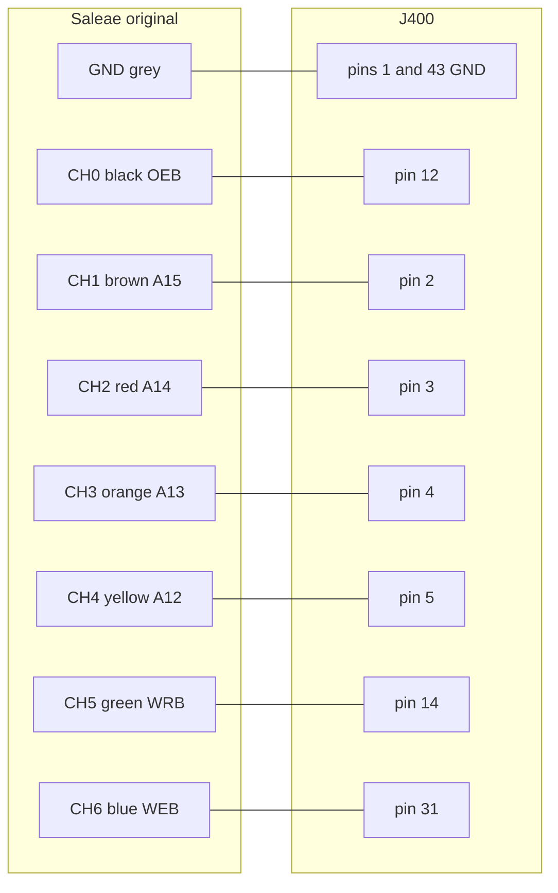

# Maxx Steele bench probes

Scripts and wiring diagrams for probing the robot with a **Bus Pirate v3.5c** and an **original Saleae Logic** (8-channel, unbuffered) while it is running. They follow the test order in the bench plan: orientation and VSW first, then clocks, then the OEB go/no-go, then reset, radio, and unused pins.

Run each script from this folder. Every script prints its hookup diagram before it does anything. Use `--wiring` to print the diagram and exit.

```bash
pip install -r requirements.txt
python3 01_orientation_power.py --port /dev/ttyUSB0
# Windows: --port COM3
```

On macOS the Bus Pirate usually shows up as `/dev/cu.usbserial-*`.

## Safety

- Keep the robot on the gel cell and unplug any charger. The Saleae shares ground with the laptop.
- Hook ground first (J400 pin 1 and/or 43). Unhook ground last.
- **J400 pin 39 is VBAT, about 10 V.** Never clip the Saleae or the Bus Pirate ADC to it. The Saleae is rated −0.5 V to 5.25 V continuous. The Bus Pirate ADC is good to 6 V. Use a regular meter on VBAT.
- Measure VSW (pin 41) with test 1 before any Saleae hookup. Neither tool will catch brief spikes; that needs a scope.
- Do not probe XTAL0 or XTAL1 (CPU pins 55 and 56).
- Leave the Bus Pirate 3.3 V, 5 V, and pull-ups off. Do not drive a pin until you know it is safe.
- Do not insert a PicoROM with `/CE` grounded until test 3 says that is safe.
- Logic 2 does not support the original Saleae. Use [Logic 1.2.18](https://support.saleae.com/) or PulseView / `sigrok-cli`. Original Saleae inputs have a weak pull-up and float around 2.4 V, so an open pin can look high.
- `sigrok-cli` loads temporary fx2lafw firmware onto the analyzer. Unplug and replug it before opening Logic 1.2.18 again.

## Cable colors

Bus Pirate v3 Seeed / firmware colors (the `v` command uses these names). SparkFun cables are often reversed; if a color is wrong, go by the pin name on the header.

| Pin | Color | Function |
|----:|-------|----------|
| 1 | brown | GND |
| 2 | red | 3.3 V (leave disconnected) |
| 3 | orange | 5.0 V (leave disconnected) |
| 4 | yellow | ADC (voltage) |
| 5 | green | VPU (leave disconnected) |
| 6 | blue | AUX (frequency) |
| 7 | purple | CLK |
| 8 | grey | MOSI |
| 9 | white | CS |
| 10 | black | MISO |

Original Saleae 1x9 harness, resistor color code. Align the grey lead with the ground symbol on the back of the unit.

| Lead | Color | Channel |
|------|-------|---------|
| Ground | grey, labeled GROUND | GND |
| 0 | black | CH0 |
| 1 | brown | CH1 |
| 2 | red | CH2 |
| 3 | orange | CH3 |
| 4 | yellow | CH4 |
| 5 | green | CH5 |
| 6 | blue | CH6 |
| 7 | violet | CH7 |

The cut proto board is the right fixture: wire-wrap test points on the fingers and clip to those. The J400 names come from the community guide and still need a continuity check for which end is pin 1 (test 1).

## Tests

### 1. Orientation and VSW — `01_orientation_power.py`

Meter first, power off, to find the two ground fingers (pins 1 and 43). Then the Bus Pirate ADC measures VSW on pin 41.

```bash
python3 01_orientation_power.py --port /dev/ttyUSB0
```

### 2. Clocks — `02_clocks.py`

Bus Pirate AUX on F2 (J400 pin 29), then F244 (CPU pin 54) and F499 (CPU pin 57) if you can reach them. The script compares the readings to 455 kHz / 2048 (~222 Hz) versus 500 kHz / 2048 (~244 Hz).

```bash
python3 02_clocks.py --port /dev/ttyUSB0
```

### 3. OEB versus address — `03_oeb_address.py`

Saleae go/no-go for the PR55 `/CE`-to-ground wiring. No PicoROM in the slot. Capture while the robot is running, export CSV, then analyze:

```bash
python3 03_oeb_address.py
# optional, if sigrok-cli is installed:
python3 03_oeb_address.py --capture --output captures/oeb_address.sr
python3 analyze_oeb.py captures/oeb_address.csv
```

If OEB is active while A15, A14, and A13 are all high (internal ROM at `$E000–$FFFF`), a cart with `/CE` tied to ground will fight the internal ROM.



### 4. Reset and NMI — `04_reset_nmi.py`

Watch RESETSYSB (pin 37) and MNMIB (pin 35). Do not pull pin 37. Capture idle, a head-stop press, and power-on.

```bash
python3 04_reset_nmi.py
python3 analyze_timing.py capture.csv --channels RESETSYSB,MNMIB,OEB
```

### 5. RadioIn — `05_radio.py`

Saleae CH0 on CPU pin 25. Press keys on the 27 MHz transmitter. Bit period is expected around 1.5–1.7 ms.

```bash
python3 05_radio.py
python3 analyze_timing.py capture.csv --channels RadioIn
```

### 6. Unused J400 DC levels — `06_unused_pins.py`

Walks the unused fingers with the Bus Pirate ADC. Pin 39 is not in the list.

```bash
python3 06_unused_pins.py --port /dev/ttyUSB0
```

## CSV exports

Name the channels in Logic 1.2.18 or PulseView to match the diagrams (`OEB`, `A15`, `A14`, `A13`, `A12`, `WRB`, `WEB`, and so on) before you export. The analyzers also accept `Channel 0` / `D0` in that hookup order if the names are still default.
